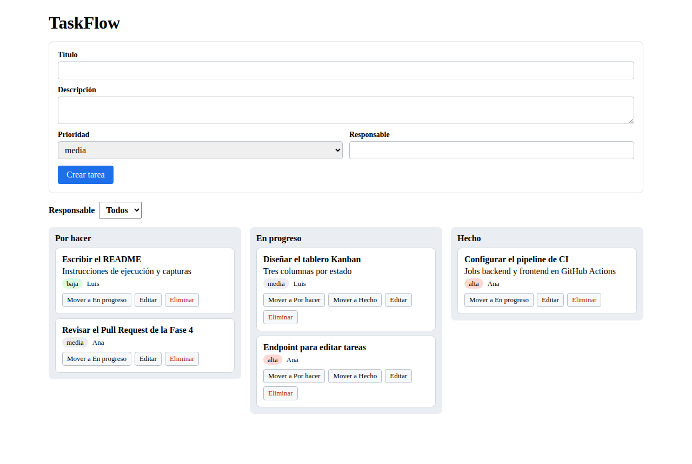
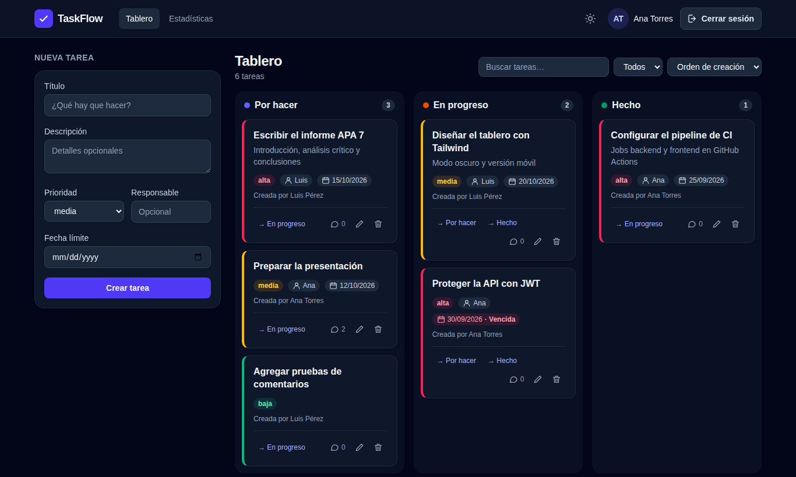
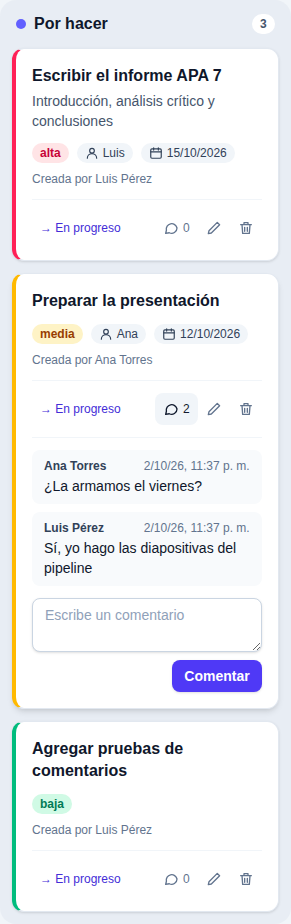
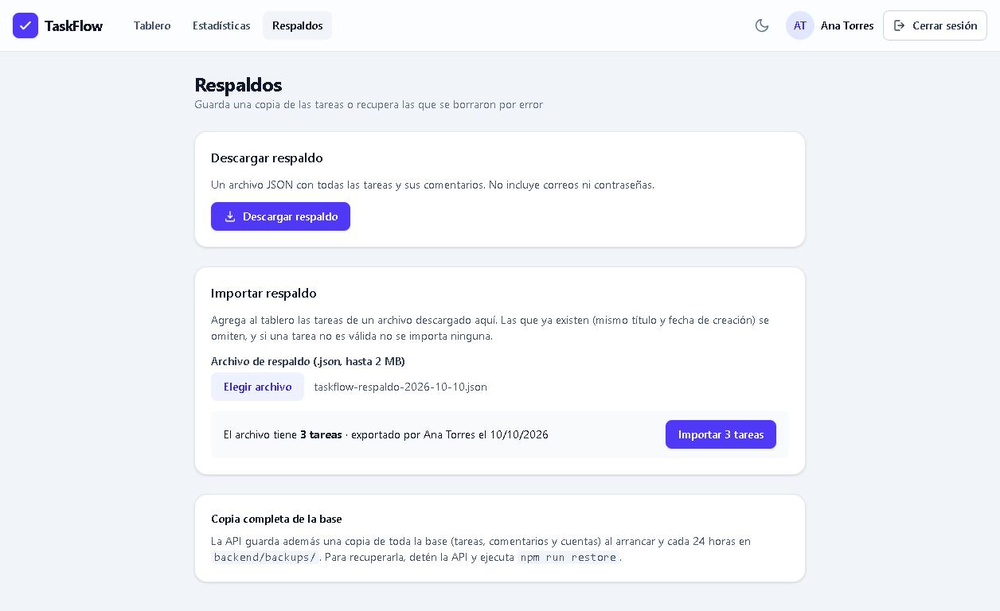
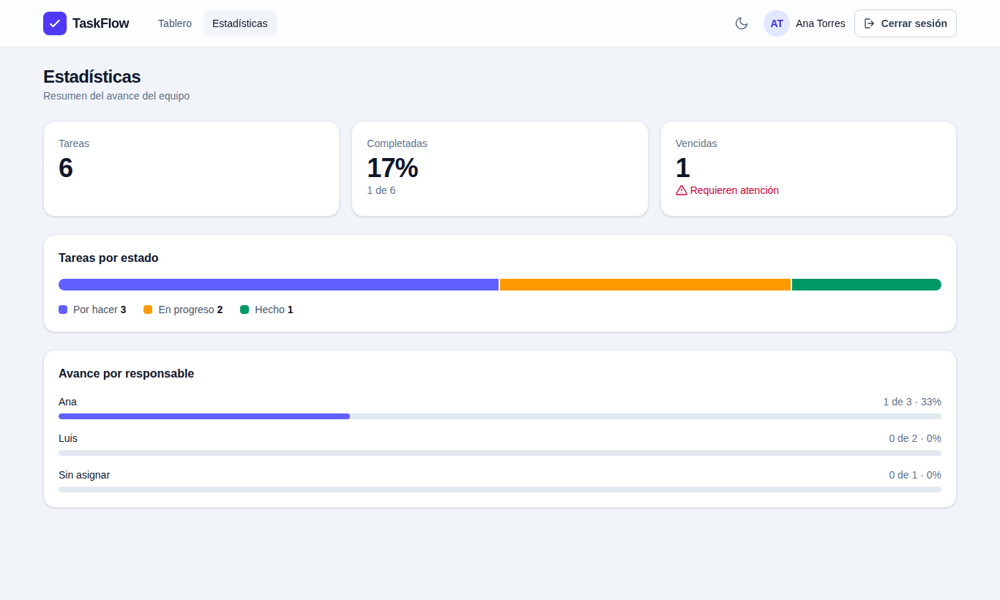
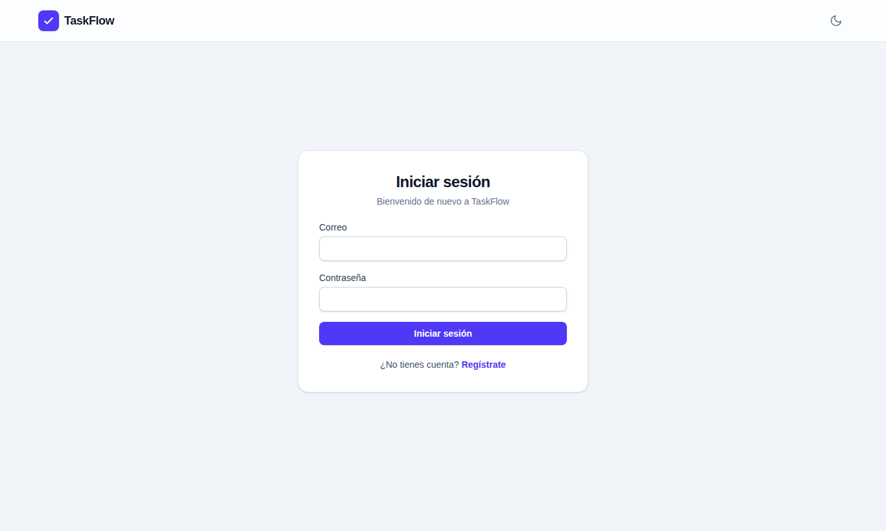
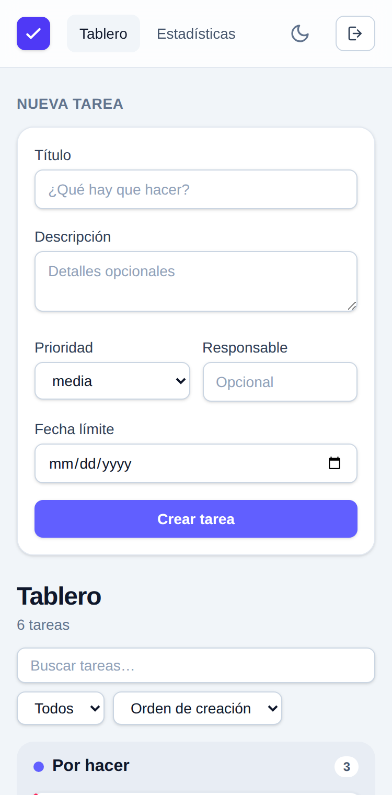

# TaskFlow — Desarrollo guiado por especificaciones con Angular y GitHub

Proyecto del Primer Parcial de **Programación Móvil**. Demuestra un modelo moderno de desarrollo de software
para una empresa ecuatoriana que pierde versiones de código, no organiza el trabajo en equipo, tiene errores
en producción y carece de documentación.

El sistema de ejemplo, **TaskFlow**, es un gestor de tareas con tablero Kanban hecho en **Angular** con una API
**Node.js/Express** y base de datos **SQLite**, desarrollado con **Spec Driven Development** usando la estructura
de **GitHub Spec Kit**.

> **¿Revisas el proyecto?** Empieza por la [guía para el docente](docs/guia-docente.md): cada punto del enunciado con
> su evidencia y un recorrido de 10 minutos. Lo que sigue está en la [hoja de ruta](docs/hoja-de-ruta.md).

## Funcionalidades

| Versión | Qué incluye | Especificación |
|---|---|---|
| v1 | Tablero Kanban con tres columnas, crear, editar, eliminar, mover entre estados y filtrar por responsable | [`001-gestor-tareas`](specs/001-gestor-tareas/spec.md) |
| v2 | Cuentas de usuario con inicio de sesión (JWT), autor de cada tarea, fecha límite y tareas vencidas, búsqueda, orden, arrastrar y soltar, comentarios, estadísticas, diseño con Tailwind CSS, modo oscuro y versión móvil | [`002-taskflow-v2`](specs/002-taskflow-v2/spec.md) |
| v3 | Respaldo automático de la base con rotación, `npm run backup` / `npm run restore`, exportar e importar las tareas en JSON desde la página **Respaldos** y validaciones más estrictas en la API y en los formularios | [`003-respaldos-validaciones`](specs/003-respaldos-validaciones/spec.md) |
| v4 | Ejecución con `docker compose up`, `/api/health`, pruebas de punta a punta con Playwright en el pipeline, cobertura mínima del 95 % en la API, análisis de seguridad con CodeQL, versiones automáticas al crear una etiqueta y API relativa con *proxy* | [`004-calidad-despliegue`](specs/004-calidad-despliegue/spec.md) |

**Seguridad**: contraseñas guardadas solo como hash bcrypt, tokens JWT que expiran en 8 horas, toda la API de
tareas y estadísticas exige sesión, el inicio de sesión no revela si el correo existe y se bloquea 15 minutos tras
5 intentos fallidos. Detalle en el [plan de la v2](specs/002-taskflow-v2/plan.md#seguridad).

**Validaciones (v3)**: la API y los formularios aplican las mismas reglas y mensajes: título de hasta 120
caracteres, descripción de hasta 1000, responsable de hasta 60, fecha límite real entre los años 2000 y 2099 y
contraseñas nuevas de al menos 8 caracteres con letras y números. La API rechaza cuerpos que no son JSON (415) y
envía las cabeceras `X-Content-Type-Options`, `X-Frame-Options` y `Referrer-Policy`.

## Cómo se resuelve cada problema de la empresa

| Problema | Solución aplicada en este repositorio |
|---|---|
| Pérdida de versiones del código | Git + GitHub, ramas `main` / `develop` / `feature/*`; y para los datos, respaldos automáticos de la base y exportación en JSON |
| Falta de organización en equipo | [Issues](https://github.com/IamCris0/spec-driven-angular-github/issues?q=is%3Aissue), [Milestones](https://github.com/IamCris0/spec-driven-angular-github/milestones?state=all), Projects (Kanban) y Pull Requests con plantilla |
| Errores frecuentes en producción | TDD + pipeline de GitHub Actions que bloquea PR con pruebas fallidas |
| Falta de documentación técnica | Especificaciones SDD en `specs/` y flujo en `docs/` |
| Sin herramientas modernas | GitHub Actions, GitHub Copilot y GitHub Spec Kit |

## Capturas



| Modo oscuro | Comentarios de una tarea |
|---|---|
|  |  |

| Respaldos |
|---|
|  |

| Estadísticas | Inicio de sesión | Móvil |
|---|---|---|
|  |  |  |

## Ejecución con Docker (un comando)

Solo hace falta [Docker Desktop](https://www.docker.com/products/docker-desktop/):

```bash
git clone https://github.com/IamCris0/spec-driven-angular-github.git
cd spec-driven-angular-github
docker compose up --build
```

Abre http://localhost:8080 y entra en **Regístrate**. nginx sirve la aplicación y reenvía `/api` a la API; la base
y los respaldos viven en volúmenes, así que sobreviven a `docker compose down` (`down -v` los borra). Para un uso
real define `JWT_SECRET` (por ejemplo en un archivo `.env` junto a `docker-compose.yml`, que Git ignora).

Restaurar un respaldo dentro de Docker:

```bash
docker compose stop api
docker compose run --rm api npm run restore -- <nombre.db>
docker compose start api
```

## Requisitos (ejecución sin Docker)

- **Node.js 22 LTS** (versión del plan y del CI). También funciona con Node 24.
- npm (incluido con Node.js) y Git.
- No hace falta Visual Studio ni Python: `better-sqlite3` usa binarios precompilados
  (`backend/.npmrc` evita que npm intente compilarlo).

## Ejecución local

Clonar e instalar dependencias (una sola vez, o cuando cambien los `package-lock.json`):

```bash
git clone https://github.com/IamCris0/spec-driven-angular-github.git
cd spec-driven-angular-github
cd backend && npm ci && cd ..
cd frontend && npm ci && cd ..
```

Levantar la aplicación en **dos terminales**:

```bash
# Terminal 1: API REST en http://localhost:3000/api
cd backend
npm start          # o "npm run dev" para reiniciar al cambiar el código

# Terminal 2: frontend en http://localhost:4200
cd frontend
npx ng serve
```

El frontend llama a la API por la ruta relativa `/api`: `ng serve` la reenvía a `http://localhost:3000`
([`proxy.conf.js`](frontend/proxy.conf.js)). Para usar otra API, define `API_TARGET` antes de `ng serve`.

Abre http://localhost:4200, entra en **Regístrate** y crea tu cuenta: el tablero solo se ve con sesión iniciada.

La primera vez la API crea la base de datos en `backend/data/taskflow.db` (Git la ignora). Si ya tenías una base
de la v1, se actualiza sola al arrancar y conserva las tareas. Para empezar de cero, detén la API y borra ese
archivo.

### Clave de los tokens (`JWT_SECRET`)

Sin `JWT_SECRET`, la API usa una clave aleatoria en cada arranque: funciona, pero las sesiones se cierran al
reiniciar la API y la consola lo avisa. Para conservarlas, define la variable antes de `npm start`:

```bash
# PowerShell
$env:JWT_SECRET = "una-clave-larga-y-secreta"
# Git Bash, macOS o Linux
export JWT_SECRET="una-clave-larga-y-secreta"
```

Con `NODE_ENV=production` la API no arranca sin `JWT_SECRET`. Nunca subas la clave al repositorio.

## Respaldos

**Automáticos.** La API copia la base al arrancar y cada 24 horas en `backend/backups/` (Git la ignora) y conserva
las últimas 10 copias. La copia usa la API de respaldo en línea de SQLite, así que es consistente aunque haya
usuarios trabajando.

| Variable | Por defecto | Para qué |
|---|---|---|
| `BACKUP_DIR` | `backend/backups` | Carpeta de los respaldos |
| `BACKUP_INTERVAL_HOURS` | `24` | Horas entre copias, de 0,1 a 596; `0` solo respalda al arrancar |
| `BACKUP_KEEP` | `10` | Copias automáticas que se conservan |
| `DB_PATH` | `backend/data/taskflow.db` | Archivo de la base |

**Manuales** (desde `backend/`):

```bash
npm run backup                     # crea un respaldo ahora (la API puede estar en marcha)
npm run restore                    # lista los respaldos, del más reciente al más antiguo
npm run restore -- <nombre.db>     # restaura uno: primero detén la API
```

Antes de reemplazar la base, `restore` comprueba que el archivo sea una base de TaskFlow sana y guarda la actual
como `antes-de-restaurar-<fecha>.db` (esas copias nunca se borran solas). Mientras la API está en marcha deja un
archivo `taskflow.db.pid`, y `restore` se niega a reemplazar la base si ese proceso sigue vivo. Un respaldo de la v1 o la v2 se
actualiza solo al arrancar.

**En JSON, desde la interfaz.** En la página **Respaldos**, "Descargar respaldo" baja todas las tareas y sus
comentarios (sin correos ni contraseñas), y "Importar respaldo" las vuelve a cargar: muestra cuántas tareas tiene el
archivo, importa todo o nada y omite las que ya existen.

## Pruebas

```bash
cd backend
npm test                    # Jest + Supertest con SQLite en memoria (242 pruebas)

cd frontend
npx ng build                # compilación de producción
npx ng test --no-watch      # Vitest + jsdom, sin navegador (173 pruebas)

cd backend
npm run test:coverage       # igual que npm test, y falla si la cobertura de líneas baja del 95 %

cd e2e
npm ci
npx playwright install chromium   # una vez (o usa el Edge o Chrome instalados: ver abajo)
npx playwright test               # 6 pruebas de punta a punta en un navegador real
```

Las pruebas de punta a punta levantan su propia API (puerto 3100) y su propio `ng serve` (4300) con una base nueva,
así que no chocan con la aplicación que tengas abierta. Para no descargar Chromium en Windows:
`$env:PW_CHANNEL = "msedge"; npx playwright test` (PowerShell). `npx playwright show-report` abre el reporte.

Son los mismos pasos que ejecuta el pipeline. Si una prueba falla en local, también fallará en el Pull Request.

## API REST

Base: `http://localhost:3000/api` (o `http://localhost:8080/api` con Docker). Todas las rutas salvo `/health`,
`/auth/register` y `/auth/login` exigen la cabecera
`Authorization: Bearer <token>`.

| Método | Ruta | Descripción | Respuestas |
|---|---|---|---|
| GET | `/health` | `{ "status": "ok" }`, para Docker y monitores | 200 |
| POST | `/auth/register` | Crea una cuenta y devuelve `{ token, user }` | 201, 400, 409 |
| POST | `/auth/login` | Inicia sesión y devuelve `{ token, user }` | 200, 400, 401, 429 |
| GET | `/auth/me` | Usuario de la sesión | 200, 401 |
| GET | `/tasks?assignee=Ana&q=texto` | Lista tareas; filtro y búsqueda opcionales y combinables | 200, 401 |
| GET | `/tasks/:id` | Obtiene una tarea | 200, 401, 404 |
| POST | `/tasks` | Crea una tarea (`due_date` opcional, `AAAA-MM-DD`) | 201, 400, 401 |
| PUT | `/tasks/:id` | Edita título, descripción, prioridad, responsable y fecha límite | 200, 400, 401, 404 |
| PATCH | `/tasks/:id/status` | Cambia solo el estado | 200, 400, 401, 404 |
| DELETE | `/tasks/:id` | Elimina una tarea y sus comentarios | 204, 401, 404 |
| GET | `/tasks/:id/comments` | Comentarios de una tarea | 200, 401, 404 |
| POST | `/tasks/:id/comments` | Agrega un comentario `{ "body": "..." }` | 201, 400, 401, 404 |
| GET | `/stats` | Totales por estado, vencidas y avance por responsable | 200, 401 |
| GET | `/backup/export` | Descarga el respaldo JSON de las tareas y sus comentarios | 200, 401 |
| POST | `/backup/import` | Importa un respaldo JSON (hasta 2 MB y 1000 tareas); responde `{ imported, skipped }` | 201, 400, 401, 413 |

Los errores responden `{ "error": "mensaje" }`, por ejemplo `400 { "error": "El título es obligatorio" }`.
Las peticiones `POST`, `PUT` y `PATCH` con un cuerpo que no es JSON responden `415`.

```bash
# 1. Crear una cuenta (o iniciar sesión con /auth/login) y copiar el "token" de la respuesta
curl -X POST http://localhost:3000/api/auth/register -H "Content-Type: application/json" -d "{\"name\":\"Ana\",\"email\":\"ana@taskflow.ec\",\"password\":\"secreta123\"}"

# 2. Usar el token en las demás peticiones
curl http://localhost:3000/api/tasks -H "Authorization: Bearer TU_TOKEN"
curl -X POST http://localhost:3000/api/tasks -H "Authorization: Bearer TU_TOKEN" -H "Content-Type: application/json" -d "{\"title\":\"Probar API\",\"due_date\":\"2026-10-31\"}"
```

En PowerShell usa `curl.exe` en lugar de `curl`.

## Pipeline de CI/CD

[`.github/workflows/ci.yml`](.github/workflows/ci.yml) se ejecuta en cada `push` y `pull_request` hacia `main` y
`develop`:

| Job | Pasos | Cuándo |
|---|---|---|
| `backend` | `npm ci` → pruebas con cobertura (mínimo 95 % de líneas) → cobertura en el resumen del run | Siempre |
| `frontend` | `npm ci` → `ng build` → `ng test` | Siempre |
| `e2e` | Playwright levanta la API y `ng serve` y Chromium recorre la aplicación; sube el reporte si falla | Siempre |
| `docker` | `docker compose up --build` y comprueba `/api/health`, un registro y una ruta de Angular a través de nginx | Siempre |
| `deploy` | build del frontend publicado como artefacto `taskflow-frontend` | Solo en push a `main`, con `backend` y `frontend` en verde |

Además:

| Workflow | Qué hace | Cuándo |
|---|---|---|
| [`codeql.yml`](.github/workflows/codeql.yml) | Análisis de seguridad del código JavaScript y TypeScript (pestaña **Security**) | Push y PR a `main` y `develop`, y cada lunes |
| [`release.yml`](.github/workflows/release.yml) | Compila el frontend y publica la versión en **Releases** con el build comprimido | Al subir una etiqueta `v*` |
| Dependabot | Abre PR con actualizaciones de dependencias | Cada semana |

`main` y `develop` están protegidas: no se puede fusionar sin PR ni con `backend` o `frontend` en rojo.

Para publicar una versión:

```bash
git tag -a v4.0.0 -m "TaskFlow v4.0.0"
git push origin v4.0.0
```

## Problemas comunes

| Síntoma | Solución |
|---|---|
| `npx ng` pregunta por *analytics* | Responde `No`. Si respondes `Yes`, el CLI escribe un ID en `frontend/angular.json`: no lo subas al repositorio. |
| `EPERM` al instalar en Windows | OneDrive bloquea `node_modules`: pausa la sincronización o mueve el proyecto fuera de OneDrive (por ejemplo `C:\dev`). |
| `npm install` falla con `edgesOut` en el frontend | Usa `npm ci`, que respeta el `package-lock.json`. |
| Puerto 3000, 4200 u 8080 ocupado | Cierra el proceso anterior. Para usar otra API con `ng serve`, define `API_TARGET`. |
| La interfaz dice "No se pudo conectar con el servidor" | La API no está corriendo: inicia `npm start` en `backend/` (con Docker: `docker compose ps`). |
| `docker compose up` falla al construir en Windows | Abre Docker Desktop y espera a que diga *Engine running*. |
| Te saca a la pantalla de inicio de sesión al reiniciar la API | Normal sin `JWT_SECRET`: defínela (ver arriba) o vuelve a iniciar sesión. |
| `npm run restore` falla con `EBUSY` o `EPERM` | La API sigue usando la base: detenla (Ctrl+C) y vuelve a intentarlo. |
| "Demasiados intentos, espera unos minutos" | 5 contraseñas incorrectas seguidas bloquean ese correo 15 minutos (o reinicia la API). |

## Estructura

```text
.specify/memory/constitution.md   Principios del proyecto (Spec Kit)
specs/
├── 001-gestor-tareas/            v1: spec.md, plan.md, tasks.md
├── 002-taskflow-v2/              v2: cuentas, diseño y productividad
├── 003-respaldos-validaciones/   v3: respaldos y validaciones
└── 004-calidad-despliegue/       v4: Docker, pruebas de punta a punta, CodeQL y versiones
docs/
├── guia-docente.md               Qué pedía el enunciado y dónde está la evidencia
├── hoja-de-ruta.md               Pasos pendientes, cómo agregar una funcionalidad y próximas versiones
├── informe/, presentacion/       Informe APA 7 (Word y Markdown), evidencias y guion
├── flujo-de-trabajo.md           Ramas, commits, PR, code review y gestión
├── verificacion.md               Verificación de requisitos y criterios de éxito
└── capturas/                     Capturas de pantalla del README
backend/
├── src/
│   ├── app.js, server.js         Aplicación Express y punto de entrada
│   ├── db.js                     Conexión SQLite y migraciones
│   ├── auth.js                   Registro, inicio de sesión, JWT y límite de intentos
│   ├── tasks.routes.js           Rutas de tareas y comentarios
│   ├── stats.routes.js           Estadísticas
│   ├── backup.js                 Copias de la base: crear, rotar, validar y restaurar
│   ├── backup.routes.js          Exportar e importar tareas en JSON
│   └── *.repository.js           Consultas SQL (tareas, usuarios, comentarios)
├── scripts/                      npm run backup y npm run restore
├── Dockerfile                    Imagen de la API
└── tests/                        Pruebas de la API (Jest + Supertest)
frontend/src/app/
├── models/                       Task, User y utilidades (vencidas, orden)
├── services/                     TaskService, AuthService, ThemeService, BackupService
├── interceptors/, guards/        Token en cada petición y rutas protegidas
├── pages/                        login, register, stats, backup
└── components/                   board, task-card, task-form, task-comments
frontend/Dockerfile, nginx.conf   Imagen del frontend con nginx
frontend/proxy.conf.js            Proxy de /api para ng serve
e2e/                              Pruebas de punta a punta (Playwright)
docker-compose.yml                TaskFlow completo con un comando
.github/workflows/                ci.yml, codeql.yml, release.yml
```

## Flujo SDD aplicado

1. **Constitución** → [`constitution.md`](.specify/memory/constitution.md)
2. **Especificación** → [v1](specs/001-gestor-tareas/spec.md), [v2](specs/002-taskflow-v2/spec.md), [v3](specs/003-respaldos-validaciones/spec.md) y [v4](specs/004-calidad-despliegue/spec.md)
3. **Plan técnico** → [v1](specs/001-gestor-tareas/plan.md), [v2](specs/002-taskflow-v2/plan.md), [v3](specs/003-respaldos-validaciones/plan.md) y [v4](specs/004-calidad-despliegue/plan.md)
4. **Tareas** → [v1](specs/001-gestor-tareas/tasks.md), [v2](specs/002-taskflow-v2/tasks.md), [v3](specs/003-respaldos-validaciones/tasks.md) y [v4](specs/004-calidad-despliegue/tasks.md)
5. **Implementación** → ramas `feature/*` con Pull Requests

Detalle del flujo de trabajo: [`docs/flujo-de-trabajo.md`](docs/flujo-de-trabajo.md).

## Referencias

- GitHub. (s. f.). *Spec Kit*. https://github.com/github/spec-kit
- EDteam. (s. f.). *Spec Driven Development*. https://ed.team/cursos/sdd
- Spec Driven. (s. f.). https://specdriven.ai/
