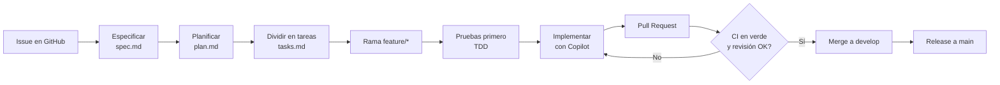
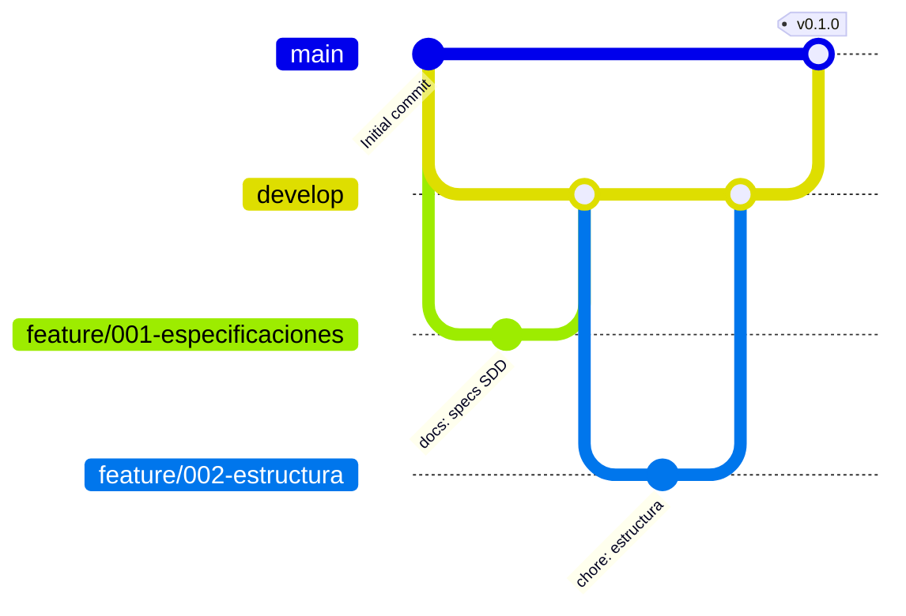

# Flujo de trabajo del equipo

Este documento describe cómo trabaja el equipo en el repositorio. Combina **Spec Driven Development (SDD)**,
**Git Flow simplificado**, **Pull Requests con revisión** y **CI con GitHub Actions**.

## 1. Ciclo de una funcionalidad



1. **Issue**: cada funcionalidad o error empieza como un Issue, con responsable y Milestone.
2. **Especificar** (`/speckit.specify`): se escribe *qué* y *por qué* en `specs/NNN-nombre/spec.md`.
3. **Planificar** (`/speckit.plan`): se decide *cómo* (tecnología, datos, API) en `plan.md`.
4. **Tareas** (`/speckit.tasks`): se divide el plan en tareas pequeñas en `tasks.md`.
5. **Implementar** (`/speckit.implement`): se programa en una rama, con pruebas primero.
6. **Pull Request**: el pipeline se ejecuta y se revisa el código (ver "Revisión en un equipo de una persona").
7. **Merge**: solo con pipeline en verde y la revisión escrita en el PR.

## 2. Estrategia de ramas: Git Flow simplificado



| Rama | Propósito | ¿Quién escribe? |
|---|---|---|
| `main` | Código estable, listo para producción | Solo merges desde `develop` |
| `develop` | Integración de funcionalidades terminadas | Solo merges de PR |
| `feature/NNN-nombre` | Una funcionalidad de `tasks.md` | El responsable de la issue |
| `fix/nombre` | Corrección de un error | El responsable de la issue |
| `docs/nombre` | Solo documentación | Cualquiera |

**¿Por qué Git Flow y no Trunk Based?** Trunk Based Development (todos integran en `main` varias veces al día)
es ideal para equipos con mucha automatización y *feature flags*. Para un equipo que **está empezando** a
ordenar su proceso, como la empresa del caso, Git Flow simplificado da más control: `develop` actúa como zona de
pruebas y `main` siempre queda estable. Cuando la cobertura de pruebas sea alta, el equipo puede migrar a Trunk
Based.

## 3. Convención de commits

Se usa [Conventional Commits](https://www.conventionalcommits.org/es/):

```
feat: agrega endpoint para crear tareas
fix: corrige validación del título vacío
test: agrega pruebas de cambio de estado
docs: actualiza especificación del tablero
ci: agrega job de pruebas del frontend
chore: actualiza dependencias
```

## 4. Pull Requests y Code Review

Cada PR debe (la [plantilla](../.github/pull_request_template.md) ya trae estos apartados):
- Referenciar su Issue (`Closes #12`).
- Explicar qué cambia y cómo probarlo.
- Indicar si se usó IA (Copilot) y qué partes se revisaron manualmente.
- Tener el pipeline en verde.

Quien revisa verifica:
- [ ] El cambio cumple la especificación (`spec.md`).
- [ ] Hay pruebas para el comportamiento nuevo.
- [ ] El código es legible y no duplica lógica.
- [ ] No hay secretos, contraseñas ni archivos de base de datos en el commit.

### Revisión en un equipo de una persona

El proyecto lo desarrolla una sola persona y GitHub no permite aprobar un PR propio. Para no perder el valor de la
revisión (Principio III, versión 1.1.0):

1. El autor recorre la lista de arriba sobre el diff completo.
2. Pide una revisión a una IA: `/code-review` de Claude Code y GitHub Copilot Chat con un prompt de revisor.
3. Evalúa cada observación (las de la IA también pueden ser falsas), corrige las válidas con una prueba primero y
   deja en el PR un comentario con la tabla de hallazgos y su veredicto.
4. Fusiona solo con el pipeline en verde.

Ejemplo: en el PR #39 la revisión encontró seis errores reales y Copilot dos más, todos corregidos con pruebas.

## 5. Protección de ramas (configuración en GitHub)

En **Settings → Branches → Add rule** (o *Rulesets*) para `main` y `develop`:
- Require a pull request before merging. Con un solo integrante, 0 aprobaciones obligatorias (GitHub no permite
  aprobar un PR propio); con dos o más, 1 aprobación.
- Require status checks to pass: jobs `backend` y `frontend`.
- Do not allow bypassing the above settings (también para administradores).

## 6. Gestión del proyecto

- **Issues**: una por cada fase de `tasks.md`, con etiquetas `feature`, `bug`, `docs`, `ci` y `gestion`. Las
  [plantillas](../.github/ISSUE_TEMPLATE/) piden la historia de usuario y sus escenarios de aceptación (o los pasos
  para reproducir un error).
- **Projects (Kanban)**: columnas *Por hacer*, *En progreso*, *En revisión*, *Hecho*.
- **Milestones**: `v0.1 – Especificaciones`, `v0.2 – MVP`, `v1.0 – Entrega final`.

## 7. Automatización de dependencias

[Dependabot](../.github/dependabot.yml) revisa cada semana las dependencias del backend, del frontend y de las
acciones de GitHub, y abre Pull Requests hacia `develop` con la etiqueta `ci`. Esos PR pasan por el mismo pipeline
y la misma revisión que cualquier otro cambio: así las alertas de seguridad no se acumulan.

## 8. Estado real del proceso

Este documento describe el flujo al que apunta el equipo. Lo que se cumplió y lo que no queda registrado, sin
maquillar, en [`verificacion.md`](verificacion.md):

- Las issues de las Fases 1 a 9 y del mantenimiento (#21 a #31) se crearon **después** de hacer el trabajo, para que
  cada fase quedara trazada con su PR. Desde la v3 (#32) la issue va primero.
- Hasta el PR #20 ningún PR tuvo revisión y `main` recibió dos push directos. Desde el PR #39 cada PR lleva una
  revisión escrita (asistida por IA) y las ramas se protegen con PR y checks obligatorios (issue #36).
- El proyecto es individual: no hay un segundo integrante que apruebe (issue #37, cerrada como no aplicable).
