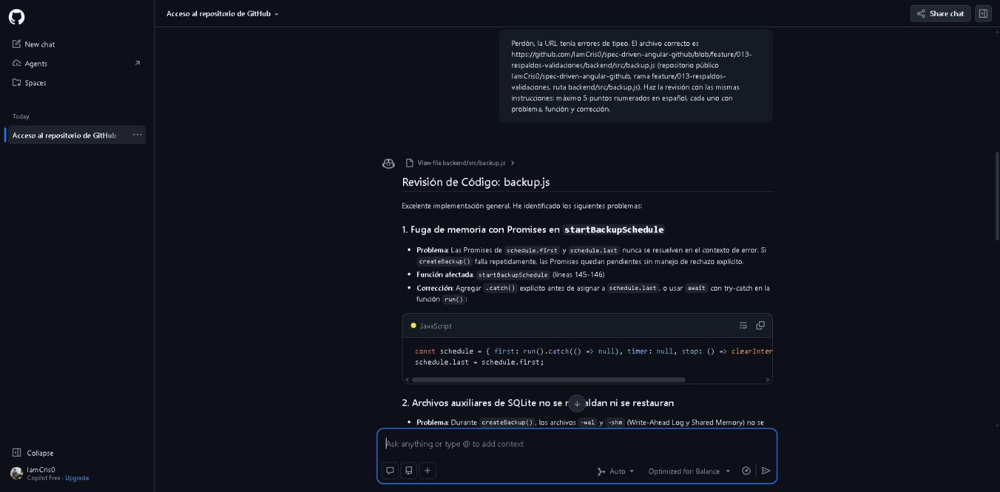
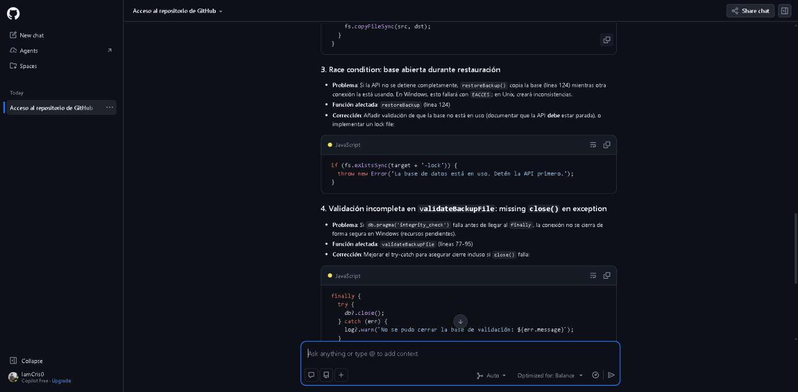
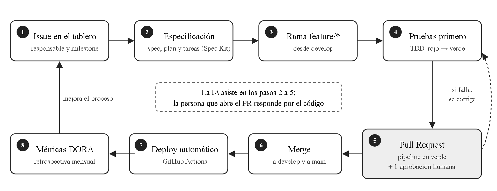
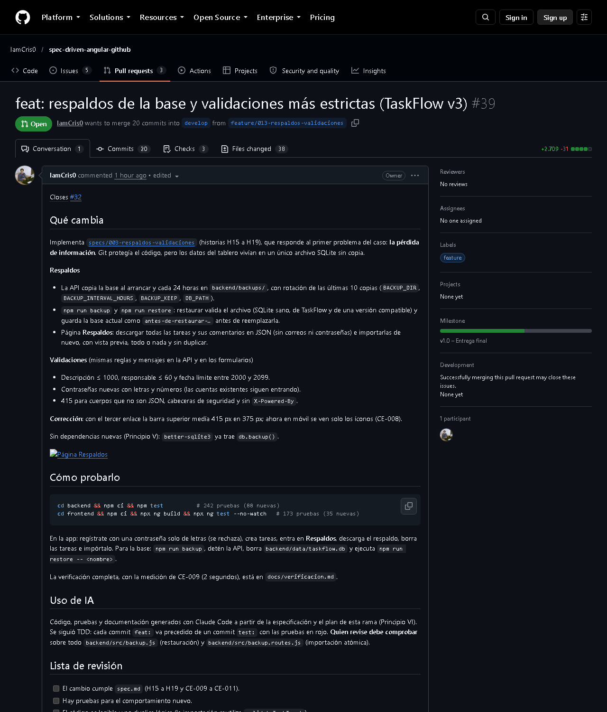
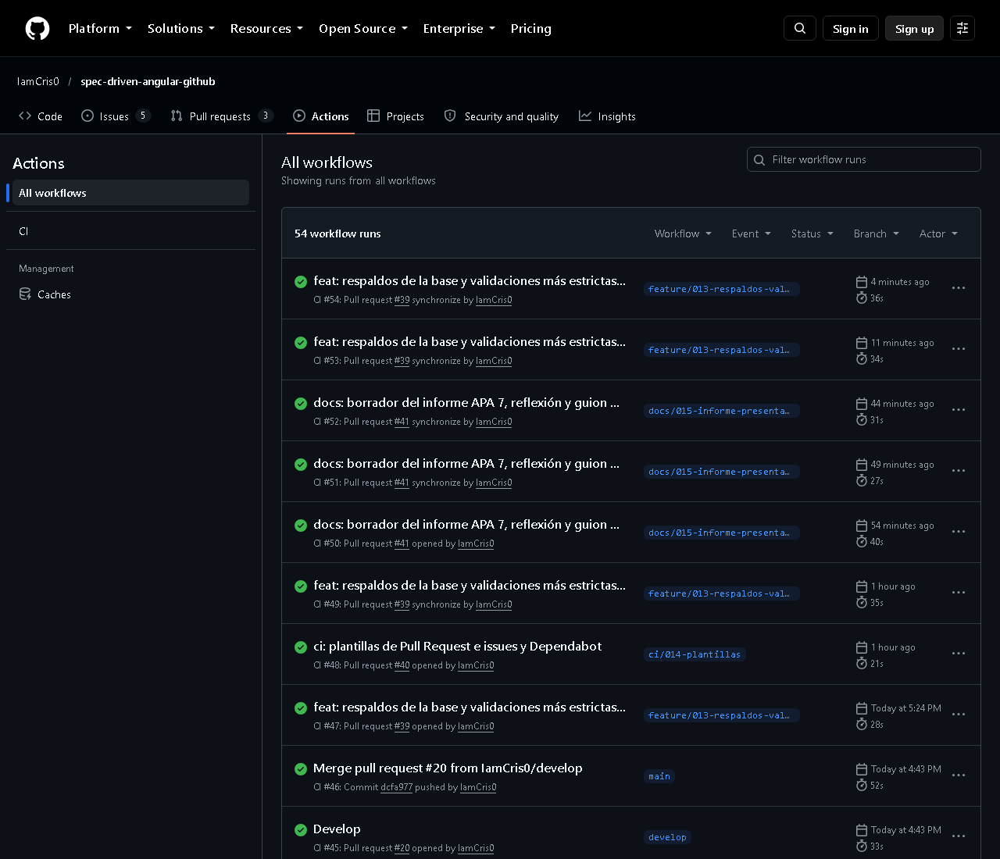
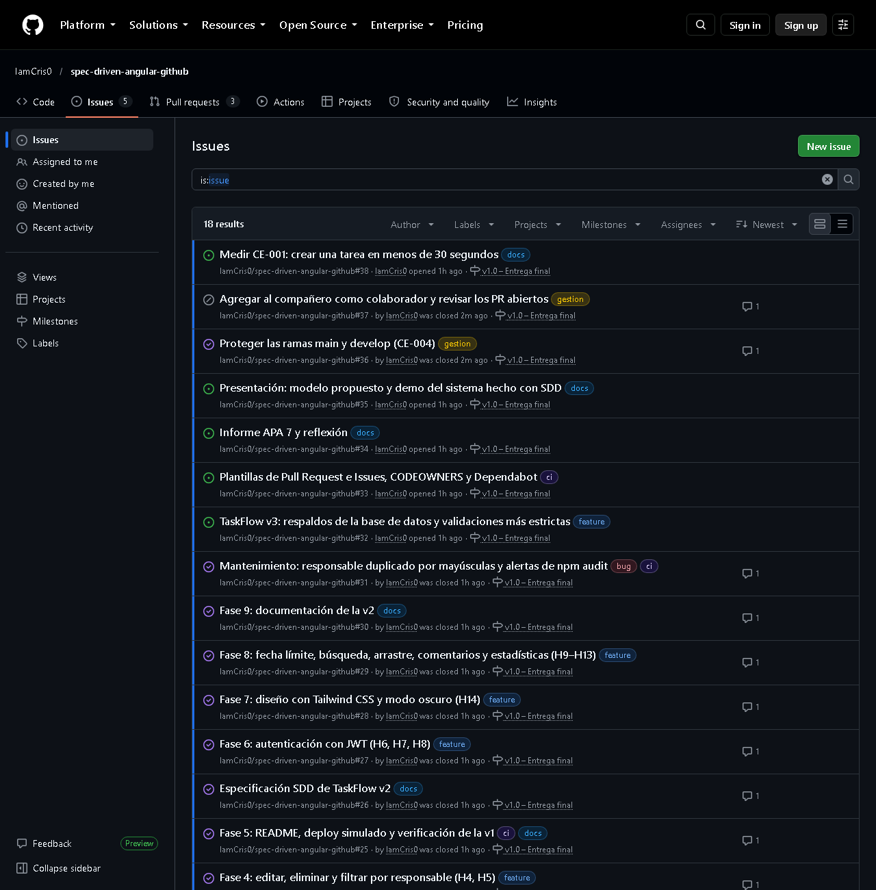
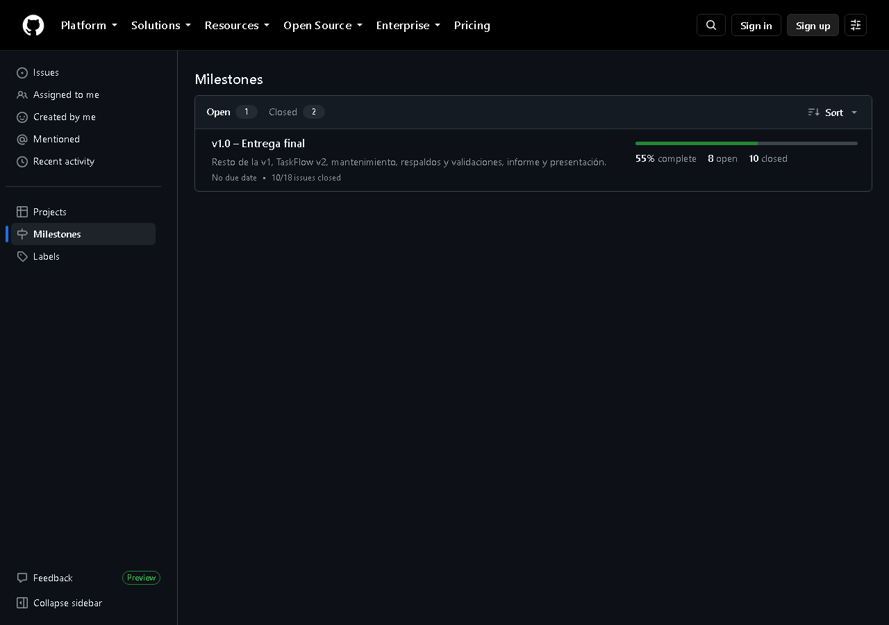
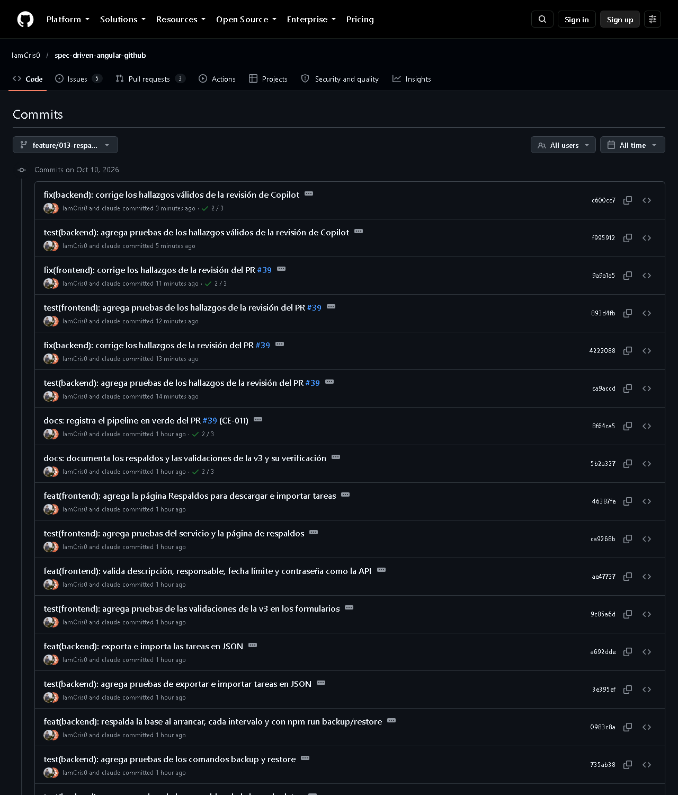
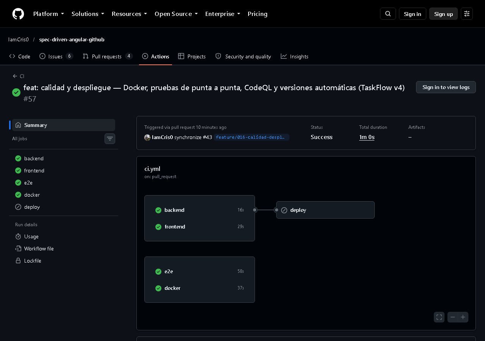

# Un modelo moderno de desarrollo de software basado en especificaciones, GitHub e inteligencia artificial: propuesta para una empresa ecuatoriana

> **Borrador para revisar.** Los datos entre corchetes los completa el autor. La versión en Word
> con formato APA 7 (Times New Roman 12, doble espacio, sangría francesa en las referencias y número de página) se
> genera a partir de este archivo. Ver [`LEEME.md`](LEEME.md).

**[Nombre y apellido]**

[Facultad], [Universidad]

Programación Móvil — Proyecto del Primer Parcial

[Nombre del docente]

[Fecha de entrega]

---

## Resumen

Una empresa de software ecuatoriana pierde versiones de su código, no coordina el trabajo del equipo, sufre errores
en producción, no documenta y no automatiza. Este informe investiga siete áreas que responden a esos problemas
—control de versiones, trabajo colaborativo, desarrollo guiado por especificaciones (SDD), DevOps, inteligencia
artificial (IA) aplicada a la programación, calidad de software y gestión de proyectos— y las aplica en un sistema
real: TaskFlow, un gestor de tareas con Angular, una API REST en Node.js y una base de datos SQLite, construido en
cuatro versiones con GitHub Spec Kit, Pull Requests y un pipeline de GitHub Actions. El análisis crítico muestra que la
combinación de especificaciones, pruebas automatizadas e integración continua permitió entregar 24 historias de
usuario con 431 pruebas automáticas —incluidas pruebas de punta a punta en un navegador real— y una aplicación que
se ejecuta con un solo comando en contenedores, pero también que las prácticas
humanas —la revisión de código y la protección de ramas— no se cumplieron durante la mayor parte del proyecto, y que
la IA generó la mayor parte del código. El proyecto se realizó de forma individual, y la revisión se resolvió con
IA: dos revisiones (Claude Code y GitHub Copilot) encontraron ocho errores reales y tres falsos positivos. Con esas lecciones se propone un modelo de adopción en cuatro fases, con políticas, roles y métricas, para
una empresa real como la Universidad Técnica de Machala (UTMACH) o una startup.

*Palabras clave*: Spec Driven Development, GitHub Actions, integración continua, desarrollo guiado por pruebas,
GitHub Copilot

---

## Introducción

La situación problemática del proyecto describe una empresa de desarrollo de software en Ecuador con cinco
problemas: pérdida de versiones del código, falta de organización en el trabajo en equipo, errores frecuentes en
producción, falta de documentación técnica y ausencia de herramientas modernas y de automatización. No son
problemas aislados. Sin control de versiones no hay forma de saber qué cambió antes de un error; sin documentación
cada integrante interpreta los requisitos a su manera; sin automatización las pruebas dependen de la memoria de
quien entrega. La empresa no necesita una herramienta, sino un **modelo de trabajo** en el que cada práctica cubra
el punto débil de la otra.

El objetivo de este trabajo es diseñar ese modelo y demostrarlo en un sistema construido con él. Siguiendo el
enfoque de Aprendizaje Basado en Problemas, primero se investigan los siete bloques temáticos del proyecto; luego se
aplican en TaskFlow, un gestor de tareas tipo Kanban desarrollado con Angular, Express y SQLite en el repositorio
público [`IamCris0/spec-driven-angular-github`](https://github.com/IamCris0/spec-driven-angular-github); después se
analiza con honestidad qué funcionó y qué no; y por último se propone un plan de adopción para la empresa.

El enunciado plantea el proyecto para dos estudiantes; este trabajo se realizó de forma individual. Esa condición
afecta sobre todo a la revisión de código, y el informe explica cómo se resolvió y qué haría distinto una empresa.

El informe se organiza así: el desarrollo de temas presenta cada bloque con su fundamento, su aplicación en TaskFlow
y una valoración; el análisis crítico contrasta lo planificado con lo que muestra el historial del repositorio; la
propuesta describe el modelo, su hoja de ruta y sus métricas; y las conclusiones y la reflexión cierran el trabajo.

---

## Desarrollo de temas

### Bloque 1: Control de versiones

#### Git y sus conceptos avanzados

Git es un sistema de control de versiones distribuido: cada copia del repositorio contiene la historia completa del
proyecto, de modo que perder un equipo no significa perder el código (Chacon & Straub, 2014). Su unidad de trabajo
es el *commit*, una instantánea identificada por un hash que apunta a su commit padre. Sobre esa base se construyen
los conceptos que importan en un equipo profesional:

- **Ramas**: punteros ligeros a un commit que permiten trabajar en paralelo sin afectar la versión estable.
- **Merge y rebase**: dos formas de integrar ramas. *Merge* conserva la historia tal como ocurrió y crea un commit de
  unión; *rebase* reescribe los commits sobre otra base para obtener una historia lineal, y no debe usarse sobre
  ramas que otros ya descargaron.
- **Etiquetas (tags)**: nombres permanentes para versiones publicadas (por ejemplo `v2.0.0`).
- **Herramientas de recuperación**: `git reflog` registra a dónde apuntó cada rama y permite recuperar commits que
  parecían perdidos; `git bisect` hace una búsqueda binaria en la historia para encontrar el commit que introdujo un
  error; `git cherry-pick` copia un commit concreto a otra rama, útil para llevar una corrección urgente a producción.
- **Hooks**: scripts que Git ejecuta antes o después de ciertas acciones (por ejemplo, impedir un commit si las
  pruebas fallan).

Un historial útil exige además commits pequeños y mensajes con significado. La convención **Conventional Commits**
(`feat:`, `fix:`, `test:`, `docs:`…) hace que la historia se pueda leer y procesar con herramientas (Conventional
Commits, s. f.).

#### Git Flow frente a Trunk Based Development

**Git Flow**, propuesto por Driessen (2010), separa una rama `main` con lo que está en producción, una rama `develop`
de integración y ramas de corta vida para funcionalidades (`feature/*`), versiones (`release/*`) y correcciones
urgentes (`hotfix/*`). **Trunk Based Development**, en cambio, hace que todos integren en una sola rama principal al
menos una vez al día, con ramas que viven horas y funcionalidades incompletas ocultas tras *feature flags*
(Hammant, s. f.).

| Criterio | Git Flow | Trunk Based Development |
|---|---|---|
| Ramas de larga vida | `main` y `develop` | Solo `main` |
| Frecuencia de integración | Al terminar cada funcionalidad | Varias veces al día |
| Requisitos previos | Pocos | Pruebas automáticas fiables, *feature flags* y revisión rápida |
| Riesgo principal | Ramas que divergen y conflictos grandes al fusionar | Romper `main` si las pruebas son débiles |
| Encaja con | Equipos que empiezan a ordenarse, versiones planificadas | Equipos maduros con despliegue continuo |

La investigación de DORA asocia el desarrollo basado en tronco con un mejor desempeño de entrega (Forsgren et al.,
2018), pero esa ventaja depende de tener pruebas y automatización sólidas. Por eso TaskFlow usa un **Git Flow
simplificado** (sin ramas `release/*`): `main` estable, `develop` de integración y ramas `feature/*`, `fix/*`,
`docs/*` y `ci/*`. Para la empresa del caso, que hoy no tiene ni control de versiones fiable, es el punto de partida
razonable; la propuesta plantea migrar a ramas más cortas cuando la cobertura de pruebas lo permita.

#### Aplicación en TaskFlow

Hasta la v2 (PR #20), el repositorio tenía 81 commits en `main` desde el 29 de septiembre de 2026, 15 ramas de trabajo y mensajes con
Conventional Commits: 17 `feat`, 17 `test`, 13 `docs`, 5 `build`, 4 `chore`, 2 `ci` y 2 `fix`. Que haya tantos
commits `test` como `feat` no es casualidad: es la huella del ciclo de pruebas primero (Bloque 6).

### Bloque 2: Trabajo colaborativo

#### GitHub y los Pull Requests

GitHub añade a Git lo que un equipo necesita para coordinarse: un repositorio central, permisos, issues, tableros y,
sobre todo, **Pull Requests (PR)**. Un PR es una propuesta para fusionar una rama en otra; reúne en un solo lugar el
diff, la discusión, los resultados del pipeline y las aprobaciones (GitHub, s. f.-c). Con **protección de ramas**,
GitHub puede impedir que alguien fusione sin un número mínimo de aprobaciones o con el pipeline en rojo (GitHub,
s. f.-b).

#### Code Review

La revisión de código es la lectura del cambio por alguien distinto de su autor antes de integrarlo. Bacchelli y Bird
(2013) estudiaron revisiones en Microsoft y encontraron que, aunque los desarrolladores esperan sobre todo encontrar
defectos, los resultados más frecuentes son la **transferencia de conocimiento**, el conocimiento compartido del
código y la mejora de su legibilidad. En un equipo pequeño esto es crítico: si solo una persona entiende el código,
la empresa depende de ella. Una buena revisión comprueba que el cambio cumple la especificación,
que tiene pruebas, que es legible y que no expone secretos; TaskFlow formaliza esa lista en
`docs/flujo-de-trabajo.md` y en la plantilla de PR.

#### Aplicación en TaskFlow

Los PR #1 a #20 se fusionaron con el pipeline en verde, pero **ninguno tuvo revisión** y 13 no tenían descripción:
es el principal hallazgo del análisis crítico. Desde el PR #39 cada PR sigue la plantilla (issue enlazada, cómo
probar, uso de IA y lista de revisión) y lleva una revisión escrita.

#### Revisión de código en un equipo de una persona

GitHub no permite aprobar un PR propio, así que un desarrollador solo no puede cumplir la regla clásica de "una
aprobación". La constitución se enmendó (versión 1.1.0) para sustituirla por una revisión documentada: el autor
recorre la lista de revisión sobre el diff, pide una revisión a una IA, evalúa cada observación y corrige las
válidas con una prueba primero. En el PR #39 (respaldos y validaciones) esta revisión encontró seis errores reales;
el más grave era que un intervalo de respaldo de más de 596 horas desbordaba el temporizador de Node.js y la API
respaldaba cada milisegundo. Todos se corrigieron con pruebas antes de fusionar. La revisión con IA no reemplaza la
transferencia de conocimiento entre personas que describen Bacchelli y Bird (2013), pero sí su función de detectar
defectos.

### Bloque 3: Desarrollo basado en especificaciones

#### Spec Driven Development

El desarrollo guiado por especificaciones (SDD) consiste en escribir una especificación antes del código y tratarla
como la fuente de verdad tanto para las personas como para la IA (Böckeler, 2025). La idea no es nueva —los
requisitos siempre se escribieron—, pero cambia de valor con los asistentes de IA: un *prompt* improvisado produce
código que compila pero no siempre hace lo que se quería, mientras que una especificación revisada fija el *qué* y el
*por qué* antes de que el agente decida el *cómo* (Delimarsky, 2025).

Böckeler (2025) distingue tres niveles de adopción: **spec-first** (la especificación se escribe antes y guía la
tarea), **spec-anchored** (la especificación se conserva y se actualiza junto al código durante la vida del sistema)
y **spec-as-source** (la especificación es el artefacto principal y el código se regenera a partir de ella).
TaskFlow está en el nivel *spec-anchored*: cada versión nueva añade su especificación sin borrar las anteriores, y
la constitución obliga a actualizar la especificación antes de cambiar un comportamiento.

#### GitHub Spec Kit

GitHub Spec Kit es un conjunto de herramientas de código abierto, publicado en septiembre de 2025, que estructura el
SDD en fases con puntos de control y plantillas: **constitución** (principios no negociables), **especificar**
(historias, escenarios de aceptación, requisitos y criterios de éxito), **planificar** (arquitectura, modelo de
datos, contrato de la API), **tareas** (lista ordenada y pequeña) e **implementar** (Delimarsky, 2025; GitHub,
s. f.-d). Funciona con varios agentes, entre ellos GitHub Copilot y Claude Code.

#### Aplicación en TaskFlow

| Artefacto de Spec Kit | En el repositorio | Contenido |
|---|---|---|
| Constitución | `.specify/memory/constitution.md` | Seis principios: especificación como fuente de verdad, pruebas primero, todo cambio por PR, automatización, simplicidad, IA como asistente |
| Especificación v1 | `specs/001-gestor-tareas/spec.md` | 5 historias (tablero, crear, mover, editar, filtrar), RF-001 a RF-007, CE-001 a CE-004 |
| Especificación v2 | `specs/002-taskflow-v2/spec.md` | 9 historias (cuentas, autoría, fechas límite, arrastre, búsqueda, comentarios, estadísticas, diseño), RF-008 a RF-017 |
| Especificación v3 | `specs/003-respaldos-validaciones/spec.md` | 5 historias (respaldos automáticos, restauración, exportar, importar, validaciones), RF-018 a RF-024 |
| Especificación v4 | `specs/004-calidad-despliegue/spec.md` | 5 historias (Docker, pruebas de punta a punta, puertas de calidad, versiones automáticas, configuración por entorno), RF-025 a RF-032 |
| Planes y tareas | `plan.md` y `tasks.md` de cada versión | 64 tareas (T001 a T064), cada fase en su rama y su PR |

Cada plan incluye una tabla que lo verifica contra la constitución y justifica cada dependencia nueva (Principio V:
simplicidad). La v3 no agregó ninguna dependencia porque la librería de SQLite ya incluía la función de respaldo en
línea. El documento `docs/verificacion.md` comprueba cada historia, requisito y criterio de éxito contra el código.

### Bloque 4: DevOps

#### CI/CD con GitHub Actions

DevOps es un conjunto de prácticas culturales y técnicas que acerca el desarrollo y la operación para entregar
cambios con frecuencia y de forma fiable (Kim et al., 2016). Dos prácticas son su núcleo. La **integración
continua (CI)** consiste en integrar el trabajo de todos con frecuencia y verificar cada integración con una
compilación y pruebas automáticas, para detectar los errores cuando todavía son pequeños (Fowler, 2006). La
**entrega continua (CD)** mantiene el software siempre en condiciones de desplegarse, con un *pipeline* que lleva cada
cambio desde el commit hasta producción con la menor intervención manual posible (Humble & Farley, 2010).

La investigación de DORA mide el desempeño de entrega con cuatro métricas: frecuencia de despliegue, tiempo de
entrega de un cambio, tasa de fallos en los cambios y tiempo de recuperación (Forsgren et al., 2018). GitHub Actions
implementa CI/CD con *workflows* en YAML dentro del propio repositorio, que se ejecutan ante eventos como un `push` o
un PR (GitHub, s. f.-a).

#### Automatización de build, test y deploy en TaskFlow

El pipeline creció con cada versión. En la v4, `.github/workflows/ci.yml` define cinco trabajos y otros dos
*workflows* completan el ciclo:

| Job o workflow | Pasos | Cuándo |
|---|---|---|
| `backend` | `npm ci` → pruebas con Jest y Supertest, con cobertura mínima del 95 % de las líneas | En cada `push` y PR hacia `main` o `develop` |
| `frontend` | `npm ci` → `ng build` → `ng test` (Vitest) | Igual |
| `e2e` | Levanta la API y el frontend y un navegador Chromium recorre la aplicación (Playwright) | Igual |
| `docker` | Construye las imágenes, las levanta con Docker Compose y comprueba la API a través de nginx | Igual |
| `deploy` | Publica el build del frontend como artefacto descargable | Solo en `push` a `main` |
| `codeql.yml` | Análisis de seguridad del código | Push, PR y cada lunes |
| `release.yml` | Publica la versión en *Releases* con el build | Al crear una etiqueta `v*` |

Ninguna ejecución del pipeline sobre `main` falló. La aplicación queda empaquetada en contenedores (una imagen para la
API y otra con nginx para el frontend) y se ejecuta con `docker compose up`; lo que no se hizo es publicarla en un
servidor de la nube, porque exige crear una cuenta en un proveedor. Además, **Dependabot** revisa cada semana las
dependencias, y **CodeQL** encontró en su primera ejecución una alerta de severidad alta (la API no limitaba las
peticiones por IP), que se corrigió con pruebas en el mismo PR. Entre el 10 y el 26 de octubre aparecieron
*advisories* nuevas en `body-parser` y en `@angular/router`; se corrigieron y `npm audit` volvió a cero. Este es el
sentido de automatizar la seguridad: las vulnerabilidades aparecen aunque el código no cambie.

### Bloque 5: Inteligencia artificial aplicada al desarrollo

#### GitHub Copilot

GitHub Copilot es un asistente de programación basado en modelos de lenguaje que sugiere código en el editor,
responde preguntas en un chat, revisa PR y, en modo agente, ejecuta tareas de varios pasos (GitHub, s. f.-e). En un
experimento controlado, los desarrolladores con Copilot implementaron un servidor HTTP en JavaScript un 55,8 % más
rápido que el grupo de control (Peng et al., 2023). Ese resultado corresponde a una tarea acotada y no mide la
productividad de un equipo en un proyecto completo.

La evidencia a escala de equipo es más matizada. El informe DORA de 2024, con más de 39 000 profesionales
encuestados, encontró que la mayoría de las organizaciones ya usa IA y que mejora la satisfacción y la sensación de
productividad individual, pero que un aumento del 25 % en su adopción se asocia con una caída estimada del 7,2 % en la
estabilidad de las entregas y del 1,5 % en su rendimiento, y que el 39 % de los encuestados confía poco o nada en el
código generado (DORA, 2024). La explicación propuesta es que la IA facilita escribir cambios más grandes, y los
cambios grandes son más riesgosos.

#### Prompt engineering para programadores

El *prompt engineering* es la práctica de redactar las instrucciones a un modelo para obtener resultados útiles y
repetibles. White et al. (2023) catalogan patrones reutilizables, como asignar un rol (*persona*), definir el formato
de salida, pedir al modelo que formule preguntas antes de responder o que verifique su propia respuesta. Para
programar, los principios prácticos son: dar **contexto** (qué archivos, qué tecnologías), fijar **restricciones**
(qué no tocar, qué convenciones seguir), pedir **cambios pequeños** y **verificables**, y exigir pruebas.

SDD puede verse como *prompt engineering* a escala de proyecto: en lugar de reescribir el contexto en cada
conversación, la constitución, la especificación y el plan quedan en el repositorio y el agente los lee siempre. Por
ejemplo, la instrucción para la v3 no fue "agrega respaldos", sino implementar `specs/003-respaldos-validaciones`,
cuyos escenarios dicen exactamente qué debe pasar si el archivo de respaldo está dañado, y cuyo plan prohíbe nuevas
dependencias.

#### Aplicación en TaskFlow y declaración de uso

La mayor parte del código, las pruebas y la documentación se generó con **Claude Code**, un agente de programación,
a partir de las especificaciones: hasta la v2, 60 de los 81 commits de `main` tenían a Claude como autor y los demás
eran, sobre todo, fusiones de PR. El autor definió el alcance de cada versión, aprobó las especificaciones, ejecutó
las pruebas y probó la aplicación. Esta concentración de autoría es un riesgo que se discute en el análisis crítico.

**GitHub Copilot.** La cuenta tiene el plan gratuito (Copilot Free), que incluye Copilot Chat en GitHub.com pero no
la revisión automática de PR, reservada a los planes de pago. Se usó Copilot Chat como segundo revisor de
`backend/src/backup.js` con un prompt construido según los patrones anteriores: rol ("actúa como revisor de código
senior"), contexto (Express, better-sqlite3, respaldos y restauración), tarea acotada (errores de correctitud en
casos borde, archivos auxiliares de SQLite, Windows y temporizadores) y formato de salida (lista de cinco puntos con
problema, función y corrección). El primer intento falló porque la URL llegó con errores de tipeo: Copilot lo
detectó y pidió la ruta correcta, una muestra de que el contexto exacto importa tanto como la instrucción.

De sus cinco observaciones, **dos eran válidas** y se corrigieron con pruebas: restaurar la base con la API en
marcha (ahora la API deja un archivo con su número de proceso y la restauración se niega mientras siga viva) y un
intervalo diminuto que también respaldaría casi cada milisegundo. **Tres eran falsos positivos**: señaló promesas sin
manejo de errores que sí lo tenían, propuso copiar el archivo `-wal` junto al respaldo —lo que lo dañaría, porque la
API de respaldo en línea de SQLite ya produce una copia consistente— y advirtió un cierre de conexión que no puede
fallar. Este resultado ilustra el Principio VI de la constitución: la IA asiste, pero cada sugerencia se verifica
antes de aplicarla (Figuras 1 y 2).

### Bloque 6: Calidad de software

#### Test Driven Development

El desarrollo guiado por pruebas (TDD) invierte el orden habitual: primero se escribe una prueba automática que falla
porque la funcionalidad no existe (rojo), después el código mínimo que la hace pasar (verde) y por último se mejora
el diseño sin cambiar el comportamiento (refactorizar) (Beck, 2003). Sus beneficios son una especificación ejecutable
del comportamiento, una red de seguridad para cambiar el código y un diseño con piezas más pequeñas y desacopladas.

#### Integración de pruebas en pipelines

Las pruebas solo protegen si se ejecutan siempre. Integrarlas en el pipeline convierte cada PR en una verificación
completa del sistema y, con protección de ramas, impide fusionar un cambio que rompe algo (Humble & Farley, 2010).

#### Aplicación en TaskFlow

| Medida | v1 | v2 | v3 | v4 |
|---|---|---|---|---|
| Pruebas de la API (Jest + Supertest, SQLite en memoria) | 72 | 154 | 242 | 251 |
| Pruebas del frontend (Vitest + jsdom) | 49 | 138 | 173 | 174 |
| Pruebas de punta a punta (Playwright) | — | — | — | 6 |
| Cobertura de líneas de la API | — | 99 % | 99 % | 99 % (mínimo exigido: 95 %) |

Las pruebas forman una pirámide: muchas pruebas unitarias y de API, rápidas y baratas, y pocas de punta a punta, que
recorren la aplicación completa en un navegador y detectan lo que las otras no ven, como una ruta mal registrada o un
*proxy* mal configurado.

En la v3 cada commit `feat:` está precedido por un commit `test:` con las pruebas que fallaban (por ejemplo,
`d1c0a4c` agrega las pruebas de validación y `faec568` las implementa). Las pruebas encontraron problemas reales: la
ruta `/estadisticas` no estaba registrada, el formulario de comentarios no enviaba y, en la v3, la barra superior
desbordaba la pantalla del celular al agregar el enlace "Respaldos". La v3 también introduce **respaldos** de la base
de datos: una copia al arrancar y cada 24 horas, con rotación y restauración validada. En la verificación, tras borrar
la base, el tablero se recuperó en 2 segundos.

### Bloque 7: Gestión del proyecto

#### Issues, Projects y Milestones

Las **issues** de GitHub registran cada unidad de trabajo —una funcionalidad, un error, una tarea de documentación—
con responsable, etiquetas y discusión, y se cierran solas cuando un PR que dice `Closes #N` se fusiona. **GitHub
Projects** organiza esas issues en un tablero **Kanban**, un método que hace visible el flujo de trabajo y limita el
trabajo en curso para terminar antes de empezar más (Anderson, 2010). Los **milestones** agrupan issues bajo una meta
con fecha y muestran el porcentaje de avance (GitHub, s. f.-f).

#### Aplicación en TaskFlow

El repositorio tiene tres milestones (`v0.1 – Especificaciones` y `v0.2 – MVP`, cerrados, y `v1.0 – Entrega final`),
etiquetas `feature`, `bug`, `docs`, `ci` y `gestion`, y 18 issues: una por cada fase y el mantenimiento (#21 a #31),
la v3 (#32), las plantillas (#33), el informe (#34), la presentación (#35), la protección de ramas (#36), la
incorporación de un segundo integrante (#37, cerrada como no aplicable) y la medición del criterio CE-001 (#38).
[Completar: enlace y captura del tablero de GitHub Projects con las columnas Por hacer, En progreso, En revisión y
Hecho.] Las issues de las fases 1 a 9 se
registraron después de hacer el trabajo; desde la v3, la issue se creó antes que el código.

---

## Análisis crítico

### Lo que funcionó

1. **La especificación redujo la ambigüedad.** Cada historia tiene escenarios "Dado–Cuando–Entonces" que se
   tradujeron casi uno a uno en pruebas automáticas. Cuando la IA generó código, el criterio para aceptarlo no fue
   "parece correcto", sino "cumple los escenarios y pasa las pruebas".
2. **El pipeline detuvo los errores antes de `main`.** Más de 50 ejecuciones exitosas no significan que nunca hubo
   errores, sino que se corrigieron en las ramas antes de fusionar.
5. **La revisión con IA encontró errores que las pruebas no cubrían.** En el PR #39, seis hallazgos de Claude Code y
   dos de Copilot, todos con una prueba que los reproduce antes de corregirlos. En el PR #43, CodeQL encontró dos
   más.
3. **La documentación se mantuvo viva.** README, especificaciones y `docs/verificacion.md` se actualizaron en el mismo
   PR que el código, y la verificación registra también lo que no se cumple.
4. **Simplicidad deliberada.** Cuatro dependencias nuevas en la v2, todas justificadas, y ninguna en la v3.

### Lo que no funcionó

1. **Durante 20 PR no hubo revisión de código.** Los PR #1 a #20 se fusionaron sin revisión y el criterio CE-004
   ("nada llega a `main` sin PR aprobado y pipeline en verde") no se cumplía. Además, `main` recibió dos *push*
   directos (`29b9ddd` y `64f2b7d`) y varios PR apuntaron a `main` en lugar de a `develop`.
2. **Las ramas se protegieron tarde.** Con una sola persona, GitHub no permite aprobar el propio PR, y exigir una
   aprobación habría bloqueado todas las fusiones; se priorizó avanzar. La protección (PR y checks obligatorios, sin
   excepciones para administradores) se configuró recién al final, junto con la revisión escrita asistida por IA. En
   una empresa esa decisión sería inaceptable: la protección de ramas es justamente lo que impide que la urgencia
   salte los controles, y debe configurarse el primer día.
3. **La IA escribió casi todo el código.** Esto aceleró el proyecto, pero concentra el riesgo: si el desarrollador no
   entiende el código, no puede mantenerlo, que es exactamente el problema de dependencia que la empresa quiere
   evitar. Lo mitigan las especificaciones, las pruebas y la verificación manual, pero no sustituyen a la revisión
   humana, y DORA (2024) muestra que la IA sin controles empeora la estabilidad.
4. **Gestión del proyecto a posteriori.** Las issues de las primeras fases se crearon al final para dejar trazabilidad.
   Sirven como registro, pero no cumplieron su función de organizar el trabajo mientras ocurría.
5. **Copilot se usó poco.** El plan gratuito no incluye la revisión automática de PR ni el agente en la nube; se usó
   Copilot Chat como segundo revisor y el desarrollo principal se hizo con otro agente. Las prácticas (especificar,
   acotar el prompt, verificar) son las mismas.
6. **Limitaciones técnicas aceptadas.** La aplicación no está publicada en un servidor de la nube (sí en contenedores
   y con versiones automáticas); SQLite no está pensado para muchos usuarios
   concurrentes; el límite de intentos de inicio de sesión vive en memoria; los respaldos se guardan en el mismo disco
   que la base; y el criterio CE-001 (crear una tarea en menos de 30 segundos) no se cronometró con usuarios.

### Lecciones

La lección principal es que **las herramientas automatizan lo técnico, pero no lo humano**. El pipeline, las pruebas
y las especificaciones se cumplieron porque la máquina los ejecuta; la revisión de código y la protección de ramas
fallaron mientras dependieron solo de la disciplina. Cuando se convirtieron en reglas (protección de ramas) y en un
paso del flujo (revisión escrita con IA), se cumplieron. Un modelo para la empresa debe convertir esas prácticas
humanas en reglas que el sistema haga cumplir.

---

## Propuesta de solución para la empresa

### Modelo propuesto

El modelo combina cinco piezas que se refuerzan entre sí:

| Problema de la empresa | Práctica | Herramienta | Cómo se mide |
|---|---|---|---|
| Pérdida de versiones del código | Git con Git Flow simplificado, *tags* por versión, ramas protegidas; respaldos automáticos de los datos | GitHub, regla 3-2-1 para las bases | Cero *push* directos a `main`; restauración probada cada mes |
| Falta de organización del equipo | Issues con responsable, tablero Kanban, milestones por entrega, PR con plantilla | GitHub Issues, Projects y Milestones | Porcentaje de PR con issue y revisión (meta: 100 %) |
| Errores frecuentes en producción | TDD, CI en cada PR, protección de ramas, despliegue automático | GitHub Actions, Jest, Vitest | Tasa de fallos en los cambios y tiempo de recuperación (DORA) |
| Falta de documentación técnica | SDD: constitución, especificación, plan y tareas versionados junto al código | GitHub Spec Kit | Toda funcionalidad nueva con `spec.md` aprobada |
| Sin herramientas modernas ni automatización | CI/CD, Dependabot, IA con política de uso | GitHub Actions, Dependabot, GitHub Copilot | Frecuencia de despliegue y tiempo de entrega (DORA) |

### Hoja de ruta de adopción

| Fase | Duración | Qué se hace | Resultado verificable |
|---|---|---|---|
| 1. Base | Semanas 1 y 2 | Migrar los proyectos a GitHub; organización con equipos; protección de `main` y `develop` (1 aprobación y checks obligatorios); plantillas de PR e issues; CODEOWNERS; capacitación en Git | Ningún cambio llega a `main` sin PR aprobado |
| 2. Automatización | Semanas 3 y 4 | Pipeline de build y pruebas en cada proyecto; Dependabot; respaldos automáticos de las bases con restauración probada | Todos los PR ejecutan el pipeline |
| 3. Especificaciones y calidad | Meses 2 y 3 | Constitución por proyecto; toda funcionalidad nueva con Spec Kit; TDD en el código nuevo; meta de cobertura del 70 % en lo nuevo | Funcionalidades con especificación y pruebas |
| 4. IA y mejora continua | Desde el mes 3 | Copilot para el equipo con política de uso; revisión de Copilot como primer filtro de los PR; despliegue continuo a un entorno de pruebas; métricas DORA mensuales | Tablero de métricas y retrospectiva mensual |

Se empieza por la fase 1 porque es la más barata y la que corrige el fallo más grave observado en este proyecto: que
los controles humanos se salten. La IA llega al final, cuando ya existen las especificaciones y las pruebas que
permiten confiar en lo que genera.

### Política de uso de IA

1. La IA es un asistente; la persona que abre el PR responde por el código (Principio VI).
2. Todo código generado pasa por pruebas y por la revisión de otra persona, igual que el código escrito a mano.
3. Los PR declaran qué se generó con IA y qué se revisó.
4. Se pide a la IA trabajar a partir de la especificación y en cambios pequeños, para evitar los lotes grandes que,
   según DORA (2024), reducen la estabilidad.
5. No se pegan secretos ni datos personales de clientes en los *prompts*.

### Roles

| Rol | Responsabilidad |
|---|---|
| Líder técnico | Aprueba la constitución y las especificaciones; mantiene la protección de ramas |
| Desarrolladores | Escriben la especificación con el equipo, las pruebas y el código; revisan los PR de sus compañeros |
| Responsable de calidad (rotativo) | Vigila el pipeline, la cobertura y los fallos en producción |
| Dueño del producto | Prioriza las issues y acepta los milestones |

### Adaptación a dos contextos reales

**Una universidad como la UTMACH.** Los sistemas académicos (matrícula, notas, horarios) cambian poco pero no pueden
fallar en fechas críticas, y el personal rota. El modelo encaja bien con Git Flow simplificado, *tags* por versión y
especificaciones que sobreviven a la rotación del personal. GitHub Education ofrece beneficios gratuitos para
estudiantes y docentes, que pueden reducir el costo de las herramientas para los equipos formados por estudiantes.
Antes de usar IA con datos institucionales habría que definir qué información puede compartirse con servicios
externos.

**Una startup.** Lo urgente es entregar rápido sin romper producción. Conviene una versión ligera: Trunk Based
Development con ramas que duren menos de un día, despliegue continuo y *feature flags*, pero sin renunciar a la
protección de `main`, a las pruebas en el pipeline ni a especificaciones breves de una página. Con dos o tres
personas, la revisión de Copilot puede ser el primer filtro, pero no sustituye la aprobación de otra persona.

### Riesgos y mitigación

| Riesgo | Mitigación |
|---|---|
| Resistencia al cambio ("antes íbamos más rápido") | Empezar por un proyecto piloto y mostrar las métricas antes y después |
| Especificaciones demasiado largas que nadie lee | Plantillas cortas; la especificación se revisa en el mismo PR que el código |
| Pruebas lentas o frágiles que bloquean el trabajo | Pruebas de API con base en memoria, como en TaskFlow; mantener el pipeline por debajo de 10 minutos |
| Dependencia de la IA sin comprensión del código | Revisión obligatoria por otra persona y rotación de quién revisa |
| Pérdida de datos aunque el código esté versionado | Respaldos automáticos fuera del servidor y restauración probada cada mes |

---

## Conclusiones

1. Los cinco problemas de la empresa tienen solución con herramientas disponibles y, en buena parte, gratuitas, pero
   la solución es un **modelo integrado**: control de versiones, especificaciones, pruebas, automatización y gestión
   se necesitan entre sí.
2. TaskFlow demuestra que el modelo funciona en la práctica: cuatro versiones con 24 historias de usuario, 431 pruebas
   automatizadas (6 de ellas de punta a punta), cobertura del 99 % en la API, análisis de seguridad, contenedores y
   documentación actualizada en cada cambio.
3. SDD es especialmente valioso cuando se programa con IA, porque convierte el contexto del proyecto en un artefacto
   versionado que guía al agente y permite verificar lo que produce.
4. Las prácticas que dependen solo de la disciplina —revisión de código, protección de ramas, gestión al día— fueron
   las que fallaron. En una empresa deben configurarse como reglas que el sistema obligue a cumplir. Para quien
   trabaja solo, la revisión asistida por IA es un sustituto útil, siempre que cada observación se verifique: de
   las cinco de Copilot, tres eran falsas.
5. La IA multiplica la velocidad, pero también los riesgos si no hay especificaciones, pruebas y revisión humana. La
   propuesta la incorpora al final de la hoja de ruta y con una política explícita.

---

## Reflexión

### ¿Qué problema resuelve Git en el desarrollo real?

Git resuelve la pérdida y el desorden de las versiones: cada cambio queda registrado con su autor, su fecha y su
motivo, y cualquier estado anterior se puede recuperar. En un equipo, además, permite trabajar en paralelo con ramas
e integrar sin pisarse. En TaskFlow eso permitió desarrollar cuatro versiones sin perder nada, saber qué commit
introdujo cada cambio y corregir un error con una rama `fix/*` sin detener el resto. Pero Git solo guarda lo que se
confirma, y no protege los datos de la aplicación: por eso la v3 agregó respaldos de la base.

### ¿Por qué DevOps es importante en la actualidad?

Porque el software ya no se entrega una vez al año: se actualiza continuamente, y cada entrega manual es una
oportunidad de error. DevOps automatiza lo repetitivo —compilar, probar, desplegar— para que los errores aparezcan en
minutos y no en producción, y mide el proceso para mejorarlo (Forsgren et al., 2018). En el proyecto, el pipeline
ejecutó cientos de pruebas en cada PR sin que nadie tuviera que recordarlo. También aprendí que DevOps es sobre
todo cultura: la automatización se cumplió y la revisión entre personas, no.

### ¿Cómo la IA está cambiando la programación?

La IA está desplazando el trabajo del programador de escribir código a **especificar, revisar y verificar** código.
En este proyecto un agente escribió la mayor parte del código en horas, algo que a mano habría tomado semanas. Pero
eso hizo más importantes las especificaciones claras, las pruebas automáticas y la capacidad de entender lo que se
integra. La evidencia lo confirma: la IA acelera tareas concretas (Peng et al., 2023), pero sin controles reduce la
estabilidad de las entregas (DORA, 2024). El programador del futuro cercano se parece más a un ingeniero que diseña y
audita que a alguien que teclea.

### ¿Qué herramienta fue más útil y por qué?

[Respuesta del autor. Sugerencia: **GitHub Actions**, porque convirtió las pruebas en una garantía y no
en una buena intención —ningún cambio llegó a `main` con pruebas fallando— y porque su valor se nota sin cambiar los
hábitos de nadie. También se puede defender **Spec Kit**, porque las especificaciones fueron lo que hizo útil a la IA.]

---

## Referencias

Anderson, D. J. (2010). *Kanban: Successful evolutionary change for your technology business*. Blue Hole Press.

Bacchelli, A., & Bird, C. (2013). Expectations, outcomes, and challenges of modern code review. En *Proceedings of the
35th International Conference on Software Engineering* (pp. 712–721). IEEE. https://doi.org/10.1109/ICSE.2013.6606617

Beck, K. (2003). *Test-driven development: By example*. Addison-Wesley.

Böckeler, B. (2025, 15 de octubre). *Understanding spec-driven-development: Kiro, spec-kit, and Tessl*.
martinfowler.com. https://martinfowler.com/articles/exploring-gen-ai/sdd-3-tools.html

Chacon, S., & Straub, B. (2014). *Pro Git* (2.ª ed.). Apress. https://git-scm.com/book/es/v2

Conventional Commits. (s. f.). *Conventional Commits 1.0.0*. https://www.conventionalcommits.org/es/v1.0.0/

Delimarsky, D. (2025, 2 de septiembre). *Spec-driven development with AI: Get started with a new open source
toolkit*. The GitHub Blog. https://github.blog/ai-and-ml/generative-ai/spec-driven-development-with-ai-get-started-with-a-new-open-source-toolkit/

DORA. (2024). *Accelerate state of DevOps report 2024*. Google Cloud. https://dora.dev/research/2024/dora-report/

Driessen, V. (2010, 5 de enero). *A successful Git branching model*. nvie.com.
https://nvie.com/posts/a-successful-git-branching-model/

EDteam. (s. f.). *Spec Driven Development* [Curso]. https://ed.team/cursos/sdd

Forsgren, N., Humble, J., & Kim, G. (2018). *Accelerate: The science of lean software and DevOps*. IT Revolution
Press.

Fowler, M. (2006, 1 de mayo). *Continuous integration*. martinfowler.com.
https://martinfowler.com/articles/continuousIntegration.html

GitHub. (s. f.-a). *Documentación de GitHub Actions*. GitHub Docs. https://docs.github.com/es/actions

GitHub. (s. f.-b). *Acerca de las ramas protegidas*. GitHub Docs.
https://docs.github.com/es/repositories/configuring-branches-and-merges-in-your-repository/managing-protected-branches/about-protected-branches

GitHub. (s. f.-c). *Acerca de las solicitudes de incorporación de cambios*. GitHub Docs.
https://docs.github.com/es/pull-requests/collaborating-with-pull-requests/proposing-changes-to-your-work-with-pull-requests/about-pull-requests

GitHub. (s. f.-d). *Spec Kit* [Repositorio de software]. https://github.com/github/spec-kit

GitHub. (s. f.-e). *Documentación de GitHub Copilot*. GitHub Docs. https://docs.github.com/es/copilot

GitHub. (s. f.-f). *Acerca de los hitos*. GitHub Docs.
https://docs.github.com/es/issues/using-labels-and-milestones-to-track-work/about-milestones

Hammant, P. (s. f.). *Trunk based development*. https://trunkbaseddevelopment.com/

Humble, J., & Farley, D. (2010). *Continuous delivery: Reliable software releases through build, test, and
deployment automation*. Addison-Wesley.

Kim, G., Humble, J., Debois, P., & Willis, J. (2016). *The DevOps handbook: How to create world-class agility,
reliability, and security in technology organizations*. IT Revolution Press.

Peng, S., Kalliamvakou, E., Cihon, P., & Demirer, M. (2023). *The impact of AI on developer productivity: Evidence
from GitHub Copilot* (arXiv:2302.06590). arXiv. https://doi.org/10.48550/arXiv.2302.06590

Spec Driven. (s. f.). *Spec Driven Development*. https://specdriven.ai/

White, J., Fu, Q., Hays, S., Sandborn, M., Olea, C., Gilbert, H., Elnashar, A., Spencer-Smith, J., & Schmidt, D. C.
(2023). *A prompt pattern catalog to enhance prompt engineering with ChatGPT* (arXiv:2302.11382). arXiv.
https://doi.org/10.48550/arXiv.2302.11382

---

## Anexo A: Evidencias en el repositorio

| Evidencia | Dónde |
|---|---|
| Repositorio | https://github.com/IamCris0/spec-driven-angular-github |
| Constitución y especificaciones | `.specify/memory/constitution.md`, `specs/001` a `specs/003` |
| Flujo de trabajo | `docs/flujo-de-trabajo.md` |
| Verificación de requisitos y criterios de éxito | `docs/verificacion.md` |
| Pipeline | `.github/workflows/ci.yml` y la pestaña **Actions** |
| Pull Requests | Pestaña **Pull requests** (#1 a #20 sin revisión; #39 a #41 con revisión escrita) |
| Revisión con IA | Comentarios de revisión en los PR #39 y #40 (Claude Code y GitHub Copilot Chat) |
| Protección de ramas | `main` y `develop`: PR y checks `backend` y `frontend` obligatorios (issue #36) |
| Issues y milestones | Pestañas **Issues** y **Milestones** |
| Ejecución con un comando | `docker-compose.yml` y los Dockerfiles: `docker compose up --build` → http://localhost:8080 |
| Pruebas de punta a punta | `e2e/tests/taskflow.spec.ts` y el job `e2e` |
| Seguridad | Pestaña **Security** (CodeQL) y `npm audit` en 0 |
| Guía para el docente y hoja de ruta | `docs/guia-docente.md` y `docs/hoja-de-ruta.md` |
| Artefacto del deploy | Actions → ejecución en `main` → Artifacts → `taskflow-frontend` |

## Anexo B: Declaración de uso de inteligencia artificial

En este proyecto se usó Claude Code (Anthropic) para generar código, pruebas, documentación, la revisión de código
de los PR #39 y #40 y el primer borrador de este informe, a partir de especificaciones aprobadas por el autor. Se usó
GitHub Copilot Chat (plan Free) como segundo revisor de `backend/src/backup.js`; sus observaciones se evaluaron una a
una (Figuras 1 y 2). El autor ejecutó las pruebas, probó la aplicación y revisó [completar: qué partes revisó
personalmente]. La responsabilidad por el contenido entregado es del autor.

## Anexo C: Capturas de evidencia

